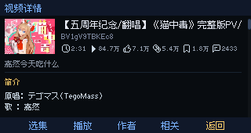
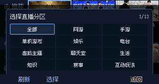

# CardputerZero-CardBili

适用于 M5Stack [CardputerZero](https://github.com/CardputerZero) 的非官方 BiliBili 客户端，支持视频、弹幕、直播等丰富功能


## 功能

- 浏览推荐、热门、关注动态、历史记录与收藏
- 查看视频详情、评论、作者作品与选集
- 视频播放、弹幕、进度跳转与倍速控制
- 直播观看、分区筛选、实时弹幕与醒目留言
- 用户内容支持 Emoji，可切换单色与彩色像素表情
- 键盘导航、多种列表布局与外观设置

## 安装

### 应用商店

在设备自带的官方应用商店搜索 **CardBili** 安装

### 手动安装

从 [Releases](https://github.com/journey-ad/M5CardputerZero-CardBili/releases) 下载 `.deb` 安装包，在设备上执行：

```sh
sudo apt install ./cardbili_*_arm64.deb
```

`*` 匹配下载的版本号，安装后从 APPLaunch 打开 CardBili

升级时执行相同命令，卸载使用 `sudo apt remove cardbili`

### 桌面版（预览用）

桌面版以窗口形式运行，功能与设备版一致，可在本机测试或非 Cardputer Zero 设备使用。构建产物发布在 [Releases](https://github.com/journey-ad/M5CardputerZero-CardBili/releases) 页面

| 平台 | 附件 |
| --- | --- |
| Linux x86_64 | `cardbili-desktop-linux-x86_64` |
| macOS Apple Silicon | `cardbili-desktop-macos-arm64` |
| Windows x86_64 | `cardbili-desktop-windows-x86_64.exe` |

Linux 与 macOS 下载后执行 `chmod +x <文件名>` 再运行，Windows 直接运行 `.exe`

macOS 首次运行如被 Gatekeeper 拦截，执行 `xattr -dr com.apple.quarantine cardbili`

桌面版播放依赖系统已安装 FFmpeg。Linux 还需 `pacat`（PipeWire 或 PulseAudio 自带），Windows 的音频直接输出到系统音频设备

## 使用

进入「我的」选择登录，使用 BiliBili App 扫描二维码并确认

| 按键 | 操作 |
| --- | --- |
| Z / X / C / F | 左 / 下 / 右 / 上 |
| Tab / Shift+Tab | 切换页签 |
| V | 切换视频列表布局 |
| B | 切换导航栏位置 |
| Enter / Space | 播放 / 查看详情 |
| Esc | 返回，视频列表中长按 2 秒退出 |
| 屏幕下方 4–8 号键 | 执行对应的底栏操作 |

## 界面

| 首页 | 热门 | 动态 |
| --- | --- | --- |
|  |  |  |

| 我的 | 设置 | 关于 |
| --- | --- | --- |
|  |  |  |

| 视频详情 | 播放 | 评论 |
| --- | --- | --- |
|  |  |  |

| 直播列表 | 分区选择 | 直播播放 |
| --- | --- | --- |
|  |  |  |

| 作者作品 | 选集 |
| --- | --- |
|  |  |

## 开发

使用 Rust 与 Slint

开发环境需要稳定版 Rust、LLVM、Docker、Python 3.11+ 和 Pillow。桌面播放还需要 FFmpeg

桌面运行：

```sh
cd cardbili
cargo run --locked --features desktop
```

从仓库根目录构建设备安装包：

```sh
rustup target add aarch64-unknown-linux-musl
rustup component add rust-docs
bash scripts/build-device.sh
python3 scripts/package-release.py
python3 scripts/check-release.py --deb dist/cardbili_*_arm64.deb
```

`dist/` 中生成 `.deb`、对应源码包和 `SHA256SUMS`

打包优先使用本机 `dpkg-deb`，缺少时通过 Docker 执行

[Cardputer Zero skill](.agents/skills/cardputer-zero/SKILL.md) 提供构建、部署、截图与设备调试说明

也可参考项目中的 [官方开发 skill](.agents/skills/cardputer-zero-application/SKILL.md)

[音视频性能报告](docs/performance/2026-11-15-playback.md) 包含真机基准评测，复测脚本保存在 `scripts/benchmarks/`

## 贡献

欢迎提交 Issues 和 Pull Request

问题反馈请附应用版本、复现步骤和相关日志，播放问题可附视频 BV 号

## 致谢

- [PiliPlus](https://github.com/bggRGjQaUbCoE/PiliPlus)：Bilibili 接口与登录实现参考
- [Slint](https://github.com/slint-ui/slint)：图形界面框架
- [FFmpeg](https://ffmpeg.org/)：音视频解码
- [Fusion Pixel Font](https://github.com/TakWolf/fusion-pixel-font)：中文像素字体
- [Mona Font](https://github.com/MonadABXY/mona-font)：Emoji 像素字体
- [Pixelarticons](https://github.com/halfmage/pixelarticons)：界面图标
- [M5Stack / CardputerZero](https://github.com/CardputerZero)：硬件平台与应用生态

## 许可证

- 项目原创代码、文档与 skill 使用 [MIT](LICENSE) 许可证
- 默认设备可执行文件包含 Slint，按 GPL-3.0-only 分发
- FFmpeg 按 LGPLv3 分发，对应源码可在 Releases 下载，详见 [第三方许可证](THIRD_PARTY_NOTICES.md)

本项目与 Bilibili、M5Stack 无隶属关系。网络功能受 Bilibili 接口与账号权限影响，视频、封面及弹幕等内容的权利归各自权利人
