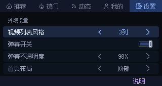
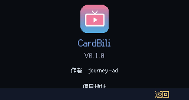
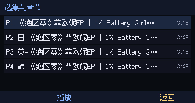

# CardBili

Cardputer Zero 上的非官方哔哩哔哩客户端


## 功能

- 浏览推荐、热门、关注动态、历史记录与收藏
- 查看视频详情、评论、作者作品与选集
- 视频播放、弹幕、进度跳转与倍速控制
- 扫码登录、关注与收藏管理
- 键盘导航、多种列表布局与外观设置

## 安装

### 应用商店

上架后可在设备的官方应用商店搜索 **CardBili** 安装

### 手动安装

从 [Releases](https://github.com/journey-ad/M5CardputerZero-CardBili/releases) 下载 `.deb` 安装包，在设备上执行：

```sh
sudo apt install ./cardbili_0.1.0_arm64.deb
```

将文件名中的版本号替换为下载的版本，安装后从 APPLaunch 打开 CardBili。升级时执行相同命令，卸载使用 `sudo apt remove cardbili`

## 使用

进入「我的」选择登录，使用哔哩哔哩 App 扫描二维码并确认

| 按键 | 操作 |
| --- | --- |
| Z / X / C / F | 左 / 下 / 右 / 上 |
| Tab / Shift+Tab | 切换页签 |
| V | 切换列表布局 |
| Enter / Space | 播放 / 查看详情 |
| Esc | 返回，视频列表中长按 2 秒退出 |
| 屏幕下方 4–8 号键 | 执行对应的底栏操作 |

## 界面

| 首页 | 热门 | 动态 |
| --- | --- | --- |
|  |  |  |

| 我的 | 设置 | 关于 |
| --- | --- | --- |
|  |  |  |

| 视频详情 | 播放 | 评论 |
| --- | --- | --- |
|  |  |  |

| 作者作品 | 作者作品 | 选集 |
| --- | --- | --- |
|  |  |  |

## 开发

使用 Rust 与 Slint。开发环境需要稳定版 Rust、LLVM、Docker、Python 3.11+ 和 Pillow；桌面播放还需要 FFmpeg

桌面运行：

```sh
cd cardbili
cargo run --locked --features desktop
```

从仓库根目录构建设备安装包：

```sh
rustup target add aarch64-unknown-linux-musl
rustup component add rust-docs
bash scripts/build-device.sh
python3 scripts/package-release.py
python3 scripts/check-release.py --deb dist/cardbili_0.1.0_arm64.deb
```

`dist/` 中生成 `.deb`、对应源码包和 `SHA256SUMS`。打包优先使用本机 `dpkg-deb`，缺少时通过 Docker 执行

[Cardputer Zero skill](skill/cardputer-zero/SKILL.md) 提供构建、部署、截图与设备调试说明；[官方开发 skill](.agents/skills/cardputer-zero-application/SKILL.md) 和 [官方发布 skill](.agents/skills/cardputer-app-publish/SKILL.md) 已安装在项目中

欢迎提交 Issues 和 Pull Request。问题反馈请附应用版本、复现步骤和相关日志，播放问题可附视频 BV 号

## 发布

商店元数据在 `app-builder.json` 中维护，版本需与 `cardbili/Cargo.toml`、`cardbili/Cargo.lock` 一致

CI 自动检查代码、凭据、商店元数据和安装包。推送 `v<版本>` 标签后生成 GitHub Release 草稿，附件包含 `.deb`、对应源码包与校验文件

提交官方应用商店前，在安装了 [czdev](https://github.com/CardputerZero/CardputerZero-AppBuilder) 和 `dpkg-deb` 的环境执行：

```sh
python3 .agents/skills/cardputer-app-publish/scripts/prepublish_check.py \
  --deb dist/cardbili_0.1.0_arm64.deb --app-dir .
czdev login
czdev publish --deb dist/cardbili_0.1.0_arm64.deb
```

首次上架需在发布 PR 中附真机运行视频，并提供公开的对应源码下载地址。也可通过 [官方发布页面](https://dev.cardputer.cc/#/upload) 提交

## 许可证

项目原创代码、文档与 skill 使用 [MIT](LICENSE) 许可证。默认设备可执行文件包含 Slint，按 GPL-3.0-only 分发；FFmpeg 按 LGPLv3 分发，Release 提供对应源码，详见 [第三方许可证](THIRD_PARTY_NOTICES.md)

本项目与 Bilibili、M5Stack 无隶属关系。网络功能受 Bilibili 接口与账号权限影响，视频、封面及弹幕等内容的权利归各自权利人
